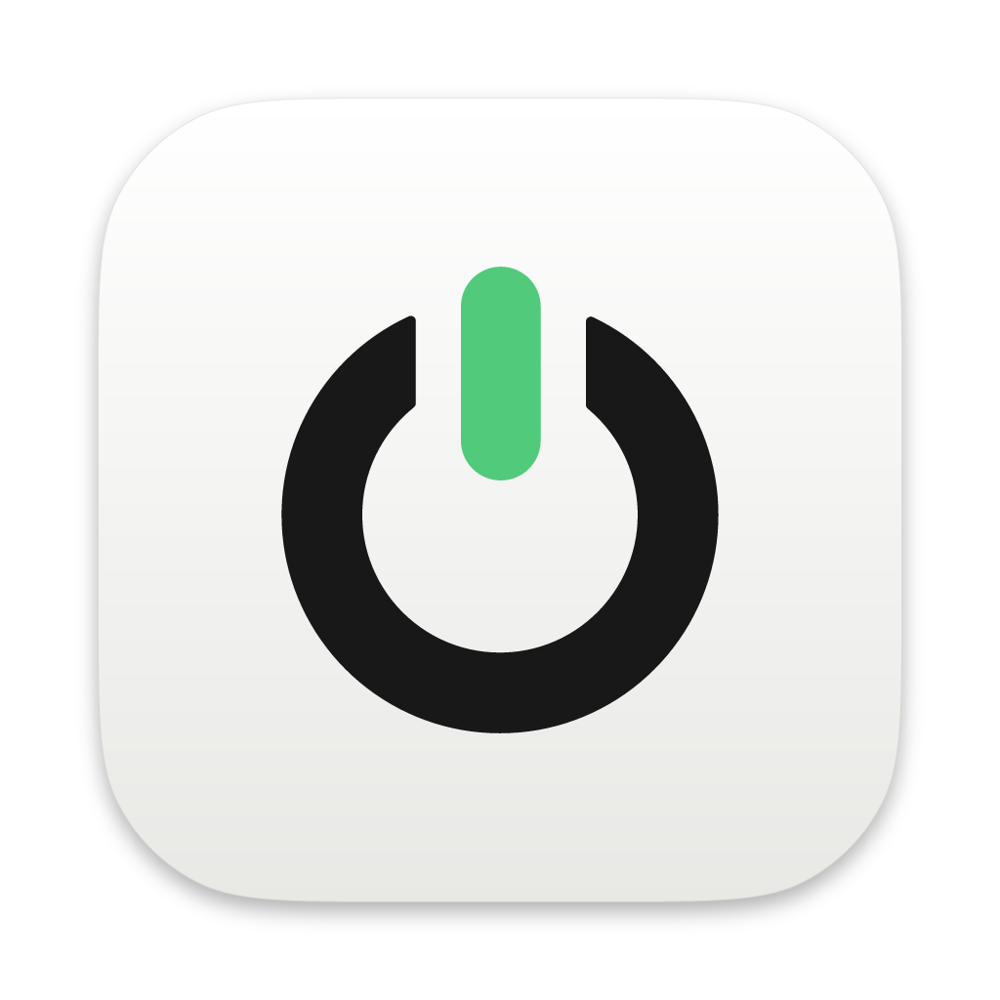
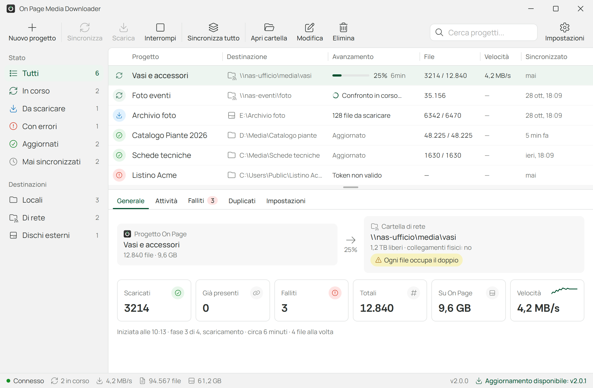
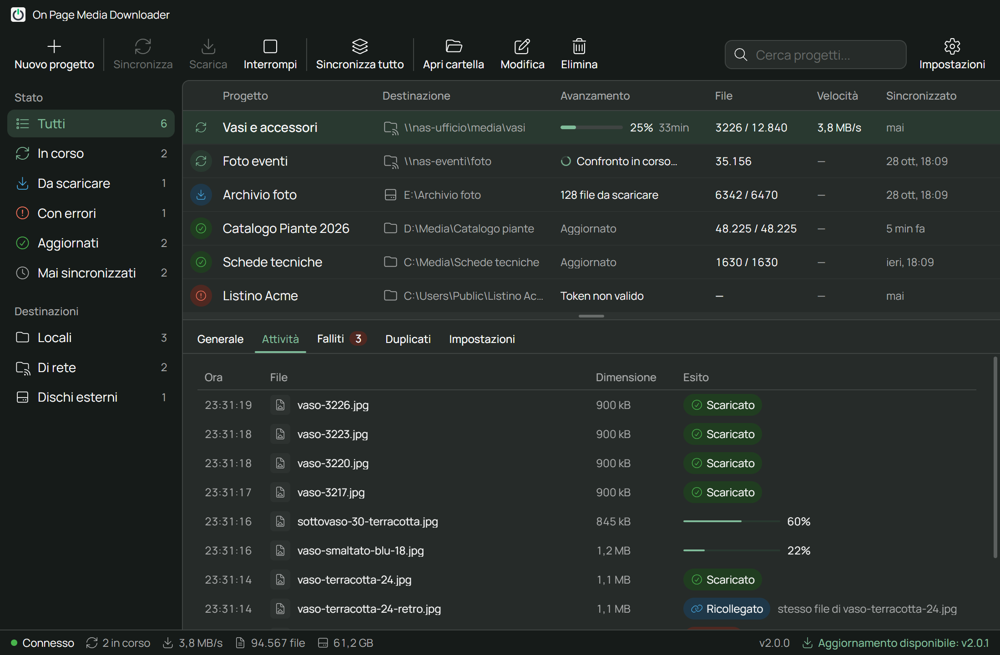
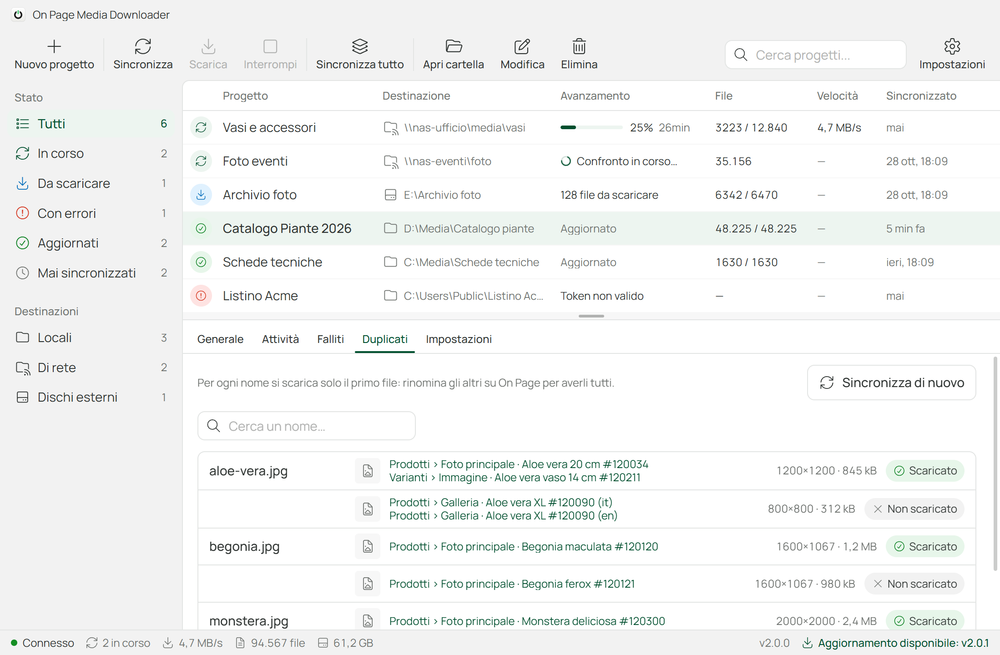
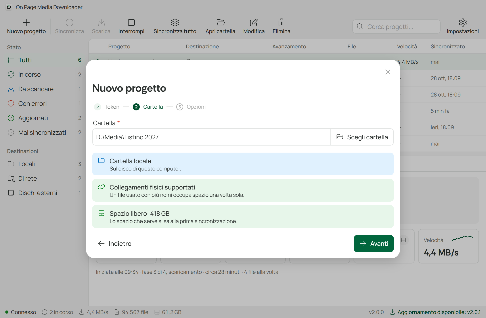
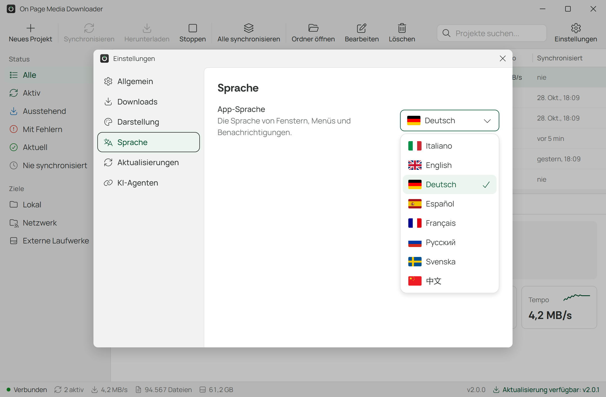
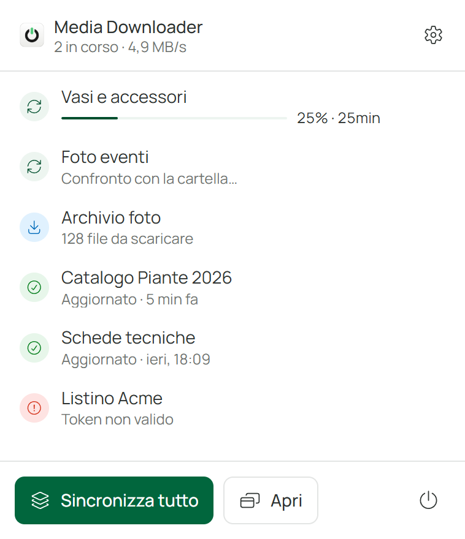
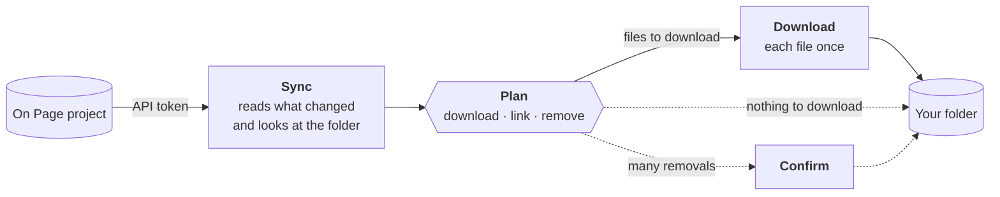

<div align="center">



# On Page® Media Downloader

**Keeps a folder on your computer, on a network share or on an external disk in sync with the media files of an On Page project.**

[](https://github.com/onpage-dev/op-media-downloader/actions/workflows/ci.yml)
[](https://github.com/onpage-dev/op-media-downloader/releases/latest)
[](LICENSE)
[](#install)

**[Download](https://github.com/onpage-dev/op-media-downloader/releases/latest)** · [User guide](https://app.onpage.it/#/help/advanced-tools/on-page-media-downloader/) · [What's new](CHANGELOG.md) · [How it works inside](docs/ARCHITECTURE.md)

</div>



Give the app an On Page [API token](https://app.onpage.it/#/help/advanced-tools/api) and a folder. It downloads every file of the project's media fields, only what the token's View shows, and from then on each sync brings the folder back in line with On Page: new files arrive, renamed files get their new name, removed files go. Layout tools, websites, shared drives and colleagues always find the latest images and documents, under their On Page names.

## Highlights

- **Every project at a glance.** One window lists your projects with their state, progress, speed and time left, filtered by state or destination. Below, the inspector shows the live activity, the failed files (retry them in one click), the names shared by several files and the project's settings.
- **Fast after the first sync.** The first sync reads the whole project; the next ones read only what changed on On Page since, thanks to a local cache. Projects with 100,000+ files stay responsive: the work runs in a process of its own.
- **Your files are safe.** The app removes only the files it created and never overwrites a file it does not know. Large removals (a wrong token, a View that changed) wait for your confirmation, nothing is removed after an incomplete read of On Page, and a folder belongs to one On Page project: a token of another project stops before touching it.
- **At home on network shares and external disks.** A full disk, a share that drops, an unplugged disk or a file open in another program stop the work cleanly, and the next sync goes on from there. A file gets its name only once it is complete and flushed to the disk: a name never holds half a file.
- **One download per file.** A file used by many items is downloaded once and gets all its names as hard links, so it takes its space once.
- **One computer at a time.** A lock in the folder keeps two computers from syncing it together, even when their clocks disagree.
- **Network friendly.** The system proxy (PAC included), timeouts, retries with backoff, On Page's rate limits respected, 1 to 10 parallel downloads and a Stop that really stops.
- **A proper desktop app.** A panel in the notification area (the menu bar on macOS), notifications, progress on the taskbar or the Dock, start with Windows or macOS, keyboard shortcuts, a folder dropped on the window starts a new project. Light and dark theme; Italian, English, German, Spanish, French, Russian, Swedish and Chinese.

## Screenshots

<table>
  <tr>
    <td width="50%"></td>
    <td width="50%"></td>
  </tr>
  <tr>
    <td align="center"><b>Activity</b>: every file as it is downloaded, linked or relinked, here in the dark theme</td>
    <td align="center"><b>Duplicates</b>: names used by more than one file on On Page; the first one is downloaded</td>
  </tr>
  <tr>
    <td></td>
    <td></td>
  </tr>
  <tr>
    <td align="center"><b>New project</b>: the token is verified and the folder checked before anything is saved</td>
    <td align="center"><b>Eight languages</b>: here the settings in German</td>
  </tr>
</table>

<table>
  <tr>
    <td width="300"></td>
    <td>
      <b>The notification area panel</b><br /><br />
      Every project and its state, <b>Sync all</b> and the main window one click away. With <i>Settings › General › Icon in the notification area</i> on, closing the window keeps the app running there, and <i>Start with the system</i> has it ready after a restart.
    </td>
  </tr>
</table>

<sub>The screenshots show demo projects with made-up data.</sub>

## How it works



1. **Sync** reads the project on On Page (after the first time, only what changed), looks at the folder and makes a plan: the files to download, the names to link or rename and the names to remove. When nothing needs downloading the plan is applied right away; otherwise the project waits under _To download_, with the number of files to download.
2. **Download** carries out the plan: each file is downloaded once into `data/` (4 at a time, up to 10), then linked under all its names. **Stop** halts it at any moment; the next **Download** goes on from there.
3. **Confirm** appears only when a sync would remove many files: more than 50, and more than a quarter of those the app created. You see the count before anything goes.

Syncs start when you ask: **Sync**, **Sync all**, the panel in the notification area, the Windows jump list or the macOS menu.

## Install

Download the installer for your system from the [latest release](https://github.com/onpage-dev/op-media-downloader/releases/latest).

| System                   | File                                          | Notes                                                                                                                    |
| ------------------------ | --------------------------------------------- | ------------------------------------------------------------------------------------------------------------------------ |
| **Windows** 10 and 11    | `op-media-downloader-<version>-x64-setup.exe` | Not code-signed yet: if SmartScreen says _Windows protected your PC_, choose **More info › Run anyway**.                 |
| **macOS**, Apple silicon | `op-media-downloader-<version>-arm64.dmg`     | Signed and notarized: open it and drag the app to Applications.                                                          |
| **macOS**, Intel         | `op-media-downloader-<version>-x64.dmg`       | As above.                                                                                                                |
| **Linux**, x64           | `.AppImage` or `.deb`                         | AppImage: make it executable (`chmod +x`) and run it. Debian and Ubuntu: `sudo apt install ./op-media-downloader-*.deb`. |

Every release lists the SHA-256 checksums of its files in `SHA256SUMS.txt` and carries a build provenance attestation, which [GitHub CLI](https://cli.github.com) checks with `gh attestation verify <file> --repo onpage-dev/op-media-downloader`.

### Upgrading from 1.x

Install 2.0 over 1.x: on Windows the installer replaces it. On its first start 2.0 imports your projects, folders and settings, and moves the API tokens to the system's encrypted storage. Files already downloaded are reused: nothing is downloaded again. Version 1.x cannot read the migrated settings, so going back is not supported.

## Getting started

1. In On Page, create an [API token](https://app.onpage.it/#/help/advanced-tools/api) for the project. Its View decides which items, and so which files, the app sees.
2. In the app, **New project** (<kbd>Ctrl</kbd>+<kbd>N</kbd>, <kbd>⌘</kbd><kbd>N</kbd> on macOS): paste the token, which is verified on the spot, then pick the folder, or drop it on the window. The app checks it: local, network or external disk, free space, hard link support, not a drive root, the user folder or a system folder, not where another project already downloads.
3. **Sync** shows what will change; **Download** does it. From then on, sync whenever you want the folder up to date.

## Your folder

```text
Catalogo piante/
├── data/                  the app's own folder: leave it as it is
│   ├── 8f3c2a…            one file per content, named by its On Page token
│   ├── manifest.json      what the app created, and for which On Page project
│   └── .lock              which computer is syncing the folder right now
├── aloe-vera.jpg          every file under its On Page name, side by side:
├── begonia.jpg            hard links to data/, or copies where the folder
├── monstera.jpg           does not support them
└── scheda-tecnica.pdf
```

- **Your own files can live there too.** The app never modifies, renames or deletes them, not even when you delete the project. A file that already has the name of one coming from On Page is never overwritten: the app takes it over only when it is clearly the same file, otherwise it reports a conflict and leaves it alone.
- **Work on copies.** A file used under several names is one file on the disk: editing it changes it under every name, and inside `data/` too.
- **Hard links save space.** A file used by ten items takes its space once. Disks formatted as FAT32 or exFAT and some network shares do not support them: there the app copies instead, every file takes twice the space, and the folder check and the project say so.

## Good to know

<details>
<summary><b>A file is missing from the folder</b></summary>

- **Two files with the same name.** When files on On Page share a name (upper and lower case count as the same), the first one is downloaded and the others are listed in the project's **Duplicates** tab. Rename them on On Page to get them all.
- **It failed.** The **Failed** tab lists the files that could not be downloaded and why; **Retry failed** tries them again. _Settings › Downloads › Retry failed files by itself_ does it once, a minute after a download, for the files that failed because of the network.
- **Its name changed.** Names follow the Windows rules on every system, since network shares are often Windows-backed: characters such as `\ / : * ? " < > |` become `_`, trailing dots and spaces go, and very long names are shortened, keeping the extension.

</details>

<details>
<summary><b>Why does the app ask before removing files?</b></summary>

When a sync would remove more than 50 files and more than a quarter of the files the app created, it stops and waits for **Confirm**: a wrong token, a View that changed or a project read only in part must not empty your folder. The confirmation covers exactly the files you were shown. With _Keep old local files that are no longer on On Page_ on, in the project's settings, nothing is ever removed.

</details>

<details>
<summary><b>"Some collections were not read"</b></summary>

Part of the project could not be read from On Page, for instance because of the network. The new files of the rest are downloaded, but nothing is removed until a sync reads everything.

</details>

<details>
<summary><b>"Folder in use"</b></summary>

Another computer is syncing the same folder, and only one at a time can. If that computer crashed or lost the network, its lock is taken over after a few minutes without news from it.

</details>

<details>
<summary><b>"Folder of another On Page project"</b></summary>

A folder holds the files of one On Page project and remembers which one; two computers can share it as long as their tokens are of that project. When you choose the folder yourself for a token of another project (a new project on that folder, or another token or folder in the project's settings), the form says so and the folder follows the new project: the files the app downloaded for the old one leave at the next sync, with the usual confirmation if they are many, or stay with _Keep old local files that are no longer on On Page_. When the folder changed project any other way, for instance from another computer, the sync stops without touching anything: choose another folder, or **Use this folder** to switch it.

</details>

<details>
<summary><b>Deleting a project</b></summary>

**Delete** removes the project from the app. With _Also delete the downloaded files_, the files the app created go too: anything else in the folder stays, and the folder itself goes only if it is left empty. A folder another On Page project took over since is left as it is.

</details>

<details>
<summary><b>Proxy and firewall</b></summary>

The app uses the system's network settings, proxy and PAC included, like the browser. It talks to On Page, for the API and the files, and to GitHub for the update check.

</details>

<details>
<summary><b>Updates</b></summary>

At start-up the app asks GitHub whether a newer version is out and says so in the status bar and in _Settings › Updates_. Download it from the [Releases](https://github.com/onpage-dev/op-media-downloader/releases) page: the app never installs anything by itself. _Check for updates_ turns the check off.

</details>

<details>
<summary><b>Where does the app keep its data?</b></summary>

| System  | Folder                                              |
| ------- | --------------------------------------------------- |
| Windows | `%APPDATA%\op-media-downloader`                     |
| macOS   | `~/Library/Application Support/op-media-downloader` |
| Linux   | `~/.config/op-media-downloader`                     |

There you find the settings and the projects (`op-media-downloader-config.json`, with the API tokens encrypted by the system's credential store), the cache of the last listings (`cache/`) and a log for support (`logs/main.log`).

</details>

## Keyboard shortcuts

| Action                      | Windows and Linux                             | macOS                                |
| --------------------------- | --------------------------------------------- | ------------------------------------ |
| New project                 | <kbd>Ctrl</kbd>+<kbd>N</kbd>                  | <kbd>⌘</kbd><kbd>N</kbd>             |
| Sync the selected project   | <kbd>Ctrl</kbd>+<kbd>R</kbd>                  | <kbd>⌘</kbd><kbd>R</kbd>             |
| Sync all                    | <kbd>Ctrl</kbd>+<kbd>Shift</kbd>+<kbd>R</kbd> | <kbd>⇧</kbd><kbd>⌘</kbd><kbd>R</kbd> |
| Open the project's folder   | <kbd>Ctrl</kbd>+<kbd>O</kbd>                  | <kbd>⌘</kbd><kbd>O</kbd>             |
| Search the projects         | <kbd>Ctrl</kbd>+<kbd>F</kbd>                  | <kbd>⌘</kbd><kbd>F</kbd>             |
| Settings                    | <kbd>Ctrl</kbd>+<kbd>,</kbd>                  | <kbd>⌘</kbd><kbd>,</kbd>             |
| Delete the selected project | <kbd>Delete</kbd>                             | <kbd>⌘</kbd><kbd>⌫</kbd>             |

The arrow keys move through the projects and the tabs; <kbd>Esc</kbd> closes menus and dialogs.

## Development

Node.js 24 (`.node-version`) and Yarn 1. No token or account is needed.

```bash
yarn              # install
yarn dev          # the app with hot reload, on a data folder of its own
yarn test         # engine, main and renderer tests
yarn typecheck
yarn lint
yarn format       # Prettier; CI runs yarn format:check
yarn build:win    # or build:mac, build:linux: the installers go to dist/
```

| Variable                                  | For development builds                                                                |
| ----------------------------------------- | ------------------------------------------------------------------------------------- |
| `OPMD_USER_DATA=<folder>`                 | Another data folder (by default `op-media-downloader-dev`, never the installed app's) |
| `OPMD_API_DOMAIN=http://127.0.0.1:<port>` | A fake On Page server, see `src/engine/testing`                                       |

```text
src/
├── main/       main process: windows, tray, menus, settings and projects
├── engine/     the sync engine, in its own process: reads, plans, downloads, links
├── preload/    window.desktop: the renderer's only way to the main process
├── renderer/   the interface: Vue 3 and Tailwind CSS 4, in eight languages
└── shared/     the contracts between the processes
```

Built with Electron 45, Vue 3.5, TypeScript 6, Tailwind CSS 4, electron-vite 6 with Vite 8, and Vitest 5. The sync engine's safety rules, flows and fault handling are in [docs/ARCHITECTURE.md](docs/ARCHITECTURE.md); read it and [CONTRIBUTING.md](CONTRIBUTING.md) before changing the engine. Security reports: [SECURITY.md](SECURITY.md).

**Icons.** Without a token the app uses the closest Font Awesome Free icons. With an On Page Font Awesome Pro token (`FONTAWESOME_NPM_AUTH_TOKEN`, or `//npm.fontawesome.com/:_authToken` in your user `.npmrc`), `yarn` (or `yarn icons`) generates the Pro light icons of the On Page design system in `src/renderer/src/lib/icons/pro.generated.ts`. That file is never committed: Font Awesome Pro icons may be embedded in the app, not published in an open-source repository.

## Releases

<details>
<summary>For maintainers</summary>

Bump `version` in `package.json`, then push a tag `vX.Y.Z`. The release workflow builds Windows, macOS (x64 and arm64) and Linux, signs and notarizes the macOS DMGs, attaches the installers with their SHA-256 checksums and build provenance to a draft release and publishes it last, so the app's update check never points at a release without installers. The Windows installer is not code-signed yet: Windows shows "unknown publisher".

Repository secrets:

- `FONTAWESOME_NPM_AUTH_TOKEN`: Font Awesome Pro token, for the design system icons (required by releases)
- `MAC_CERTIFICATE`: the .p12 Developer ID certificate, base64
- `APPLE_CERTIFICATE_PASSWORD`: the password of the .p12
- `APPLE_ID`, `APPLE_ID_PASSWORD` (an app-specific password), `APPLE_TEAM_ID`: for notarization

To notarize a DMG built locally: `xcrun notarytool submit <file>.dmg --apple-id <id> --password <app-specific password> --team-id <team> --wait`, then `xcrun stapler staple <file>.dmg`.

</details>

## License and trademarks

The code is released under the [MIT License](LICENSE). On Page® and its logo are trademarks of their owner and are not covered by the license. The licenses of the third-party software in the app are listed in `THIRD_PARTY_NOTICES.txt` (generated at build time, also opened from _Settings › Updates_).
