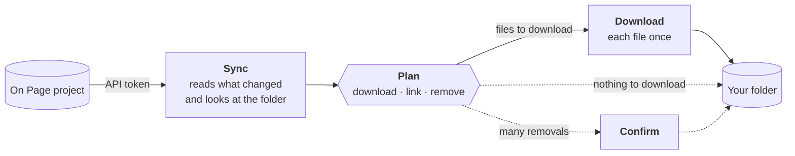

<div align="center">


# On Page® Media Downloader

**Keeps a folder on your computer, on a network share or on an external disk in sync with the media files of an On Page project.**

[](https://github.com/onpage-dev/op-media-downloader/actions/workflows/ci.yml)
[](https://github.com/onpage-dev/op-media-downloader/releases/latest)
[](LICENSE)
[](#install)

**[Download](https://github.com/onpage-dev/op-media-downloader/releases/latest)** · [User guide](https://app.onpage.it/#/help/advanced-tools/on-page-media-downloader/) · [What's new](CHANGELOG.md) · [How it works inside](docs/ARCHITECTURE.md)

</div>


Give the app an On Page [API token](https://app.onpage.it/#/help/advanced-tools/api) and a folder. It downloads the files of the project's media fields (only what the token's View shows) and from then on each sync brings the folder back in line with On Page: new files arrive, renamed ones get their new name, removed ones go. Layout tools, websites, shared drives and colleagues always find the latest images and documents under their On Page names.

## Highlights

- **Your files are safe.** The app removes only what it created, never overwrites a file it does not know, and asks before large removals.
- **Fast, even with 200,000 files.** Native, written in Rust: after the first sync only what changed on On Page is read, and the window never waits for the work.
- **Every project at a glance.** State, progress, speed and time left for every project; live activity, failed files, duplicate names and settings for the selected one.
- **At home on network shares and external disks.** A full disk, a share that drops, an unplugged disk or a file open in another program stop the work cleanly, and the next sync goes on from there. A name never holds half a file.
- **One download per file, one computer per folder.** A file used by many items is downloaded once and linked under all its names; a lock keeps two computers from syncing a folder together.
- **Network friendly.** The system proxy, retries with backoff, On Page's rate limits respected, 1 to 10 parallel downloads, a Stop that really stops.
- **Scriptable, and ready for AI agents.** `opmd` does from a terminal everything the window does, with or without the app; AI agents use the same operations through [MCP](#from-the-terminal-and-from-ai-agents).
- **A proper desktop app.** Notification area panel, notifications, taskbar and Dock progress, start at login, shortcuts, drag and drop. Light and dark, in eight languages.

## Screenshots

<table>
  <tr>
    <td width="50%"></td>
    <td width="50%"></td>
  </tr>
  <tr>
    <td align="center"><b>Activity</b>: every file as it is downloaded, linked or relinked, here in the dark theme</td>
    <td align="center"><b>Duplicates</b>: names used by more than one file on On Page; the first one is downloaded</td>
  </tr>
  <tr>
    <td></td>
    <td></td>
  </tr>
  <tr>
    <td align="center"><b>New project</b>: the token is verified and the folder checked before anything is saved</td>
    <td align="center"><b>Eight languages</b>: here the settings in German</td>
  </tr>
</table>

<table>
  <tr>
    <td width="300"></td>
    <td>
      <b>The notification area panel</b><br /><br />
      Every project and its state, <b>Sync all</b> and the main window one click away. With <i>Settings › General › Icon in the notification area</i> on, closing the window keeps the app running there, and <i>Start with the system</i> has it ready after a restart.
    </td>
  </tr>
</table>

<sub>The screenshots show demo projects with made-up data.</sub>

## How it works



1. **Sync** reads the project (after the first time, only what changed), looks at the folder and plans the files to download, the names to link or rename and those to remove. With nothing to download the plan is applied at once; otherwise the project waits under _To download_.
2. **Download** carries it out: each file once into `data/` (4 at a time, up to 10), then linked under all its names. **Stop** halts it; the next **Download** goes on from there.
3. **Confirm** appears only when a sync would remove more than 50 files and more than a quarter of those the app created. You see the count first.

Syncs start when you ask: **Sync**, **Sync all**, the notification area panel, the macOS menu, `opmd` or an AI agent.

## Install

From the [latest release](https://github.com/onpage-dev/op-media-downloader/releases/latest):

| System                   | File                                                                   | Notes                                                                                                   |
| ------------------------ | ---------------------------------------------------------------------- | ------------------------------------------------------------------------------------------------------- |
| **Windows** 10 and 11    | `op-media-downloader-<version>-x64-setup.exe`                          | Not code-signed yet: if SmartScreen stops it, **More info › Run anyway**.                               |
| **macOS**, Apple silicon | `op-media-downloader-<version>-arm64.dmg`                              | Signed and notarized: drag the app to Applications.                                                     |
| **macOS**, Intel         | `op-media-downloader-<version>-x64.dmg`                                | As above.                                                                                               |
| **Linux**, x64           | `.AppImage` or `.deb`                                                  | AppImage: `chmod +x` and run it. Debian and Ubuntu: `sudo apt install ./op-media-downloader-*.deb`.     |
| **Servers**, without app | `opmd-<version>-linux-x86_64.tar.gz`, `opmd-<version>-windows-x64.zip` | The [command line](#from-the-terminal-and-from-ai-agents) alone. The installers above already carry it. |

Each release lists the SHA-256 checksums of its files in `SHA256SUMS.txt` and has a build provenance attestation: `gh attestation verify <file> --repo onpage-dev/op-media-downloader`.

**Upgrading from 1.x.** At its first start 2.0 copies the projects, folders and settings of 1.x (leaving its folder as it is), moves the API tokens to the system's credential store (Windows Credential Manager, macOS Keychain, Secret Service on Linux) and reuses the files already downloaded. The installer does not replace 1.x: uninstall it once 2.0 shows your projects.

## Getting started

1. In On Page, create an [API token](https://app.onpage.it/#/help/advanced-tools/api) for the project: its View decides which items, and so which files, the app sees.
2. **New project** (<kbd>Ctrl</kbd>+<kbd>N</kbd>, <kbd>⌘</kbd><kbd>N</kbd> on macOS): paste the token (verified on the spot) and pick the folder, or drop it on the window. The app checks it: local, network or external disk, free space, hard links, not a drive root, the user folder, a system folder or another project's folder.
3. **Sync** shows what will change; **Download** does it. Sync whenever you want the folder up to date.

## Your folder

```text
Catalogo piante/
├── data/                  the app's own folder: leave it as it is
│   ├── 8f3c2a…            one file per content, named by its On Page token
│   ├── manifest.json      what the app created, and for which On Page project
│   └── .lock              which computer is syncing the folder right now
├── aloe-vera.jpg          every file under its On Page name, side by side:
├── begonia.jpg            hard links to data/, or copies where the folder
├── monstera.jpg           does not support them
└── scheda-tecnica.pdf
```

- **Your own files can live there too.** The app never modifies, renames or deletes them, not even with the project. A file with the name of one coming from On Page is taken over only when it is clearly the same file; otherwise it is reported as a conflict and left alone.
- **Work on copies.** A file used under several names is one file on the disk: editing it changes it everywhere, `data/` included.
- **Hard links save space.** FAT32, exFAT and some network shares do not support them: there the app copies, each file takes twice the space, and the folder check says so.

## Good to know

<details>
<summary><b>A file is missing from the folder</b></summary>

- **Two files with the same name** (upper and lower case count as the same): the first is downloaded, the others are listed in the **Duplicates** tab with the items that use them and links to edit those on On Page. Rename them there to get them all. A name with many files shows the first 10, then **Show 100 more**; the item names arrive from On Page just after.
- **It failed.** The **Failed** tab says why; **Retry failed** tries again. _Settings › Downloads › Retry failed files by itself_ does it once, a minute after a download, for network failures.
- **Its name changed.** Names follow the Windows rules on every system (network shares are often Windows-backed): `\ / : * ? " < > |` become `_`, trailing dots and spaces go, very long names are shortened keeping the extension.

</details>

<details>
<summary><b>Why does the app ask before removing files?</b></summary>

A wrong token, a View that changed or a project read only in part must not empty your folder: past 50 files and a quarter of those the app created, a sync waits for **Confirm**, which covers exactly the files you were shown. With _Keep old local files that are no longer on On Page_ (in the project's settings) nothing is ever removed.

</details>

<details>
<summary><b>"Some collections were not read"</b></summary>

Part of the project could not be read, for instance because of the network. The new files of the rest are downloaded, but nothing is removed until a sync reads everything.

</details>

<details>
<summary><b>"Folder in use"</b></summary>

Another computer is syncing the folder, and only one at a time can. If it crashed or lost the network, its lock is taken over after a few minutes without news from it.

</details>

<details>
<summary><b>"Folder of another On Page project"</b></summary>

A folder holds the files of one On Page project; computers whose tokens are of that project can share it. If you choose it for a token of another project (a new project, or another token or folder in the settings), the form says so and the folder follows: the old project's files leave at the next sync (with the usual confirmation if many) or stay with _Keep old local files that are no longer on On Page_. If it changed project any other way, for instance from another computer, the sync stops without touching it: choose another folder, or **Use this folder**.

</details>

<details>
<summary><b>Deleting a project</b></summary>

**Delete** removes it from the app. With _Also delete the downloaded files_ the files the app created go too; anything else stays, and the folder goes only if left empty (not if another On Page project took it over).

</details>

<details>
<summary><b>Proxy and firewall</b></summary>

The app uses the system's proxy (Windows and macOS settings, or `HTTPS_PROXY` and `NO_PROXY`; PAC scripts are not read) and the certificates the system trusts. It talks to On Page (API and files) and to GitHub (update check).

</details>

<details>
<summary><b>Updates</b></summary>

At start-up the app asks GitHub for a newer version and says so in the status bar and in _Settings › Updates_; download it from [Releases](https://github.com/onpage-dev/op-media-downloader/releases), the app never installs anything by itself. _Check for updates_ turns the check off.

</details>

<details>
<summary><b>Where does the app keep its data?</b></summary>

| System  | Folder                                                     |
| ------- | ---------------------------------------------------------- |
| Windows | `%APPDATA%\com.onpage.mediadownloader`                     |
| macOS   | `~/Library/Application Support/com.onpage.mediadownloader` |
| Linux   | `~/.local/share/com.onpage.mediadownloader`                |

- `op-media-downloader-config.json`: settings and projects. The API tokens are in the system's credential store, not here (unless there is none).
- `cache/`: the last listings, for fast syncs.
- `logs/main.log` and `logs/opmd.log`: for support.
- `mcp.json`: where the app's MCP server is, while it is open with _Settings › AI agents_ on.

</details>

## Keyboard shortcuts

| Action                      | Windows and Linux                             | macOS                                |
| --------------------------- | --------------------------------------------- | ------------------------------------ |
| New project                 | <kbd>Ctrl</kbd>+<kbd>N</kbd>                  | <kbd>⌘</kbd><kbd>N</kbd>             |
| Sync the selected project   | <kbd>Ctrl</kbd>+<kbd>R</kbd>                  | <kbd>⌘</kbd><kbd>R</kbd>             |
| Sync all                    | <kbd>Ctrl</kbd>+<kbd>Shift</kbd>+<kbd>R</kbd> | <kbd>⇧</kbd><kbd>⌘</kbd><kbd>R</kbd> |
| Open the project's folder   | <kbd>Ctrl</kbd>+<kbd>O</kbd>                  | <kbd>⌘</kbd><kbd>O</kbd>             |
| Search the projects         | <kbd>Ctrl</kbd>+<kbd>F</kbd>                  | <kbd>⌘</kbd><kbd>F</kbd>             |
| Settings                    | <kbd>Ctrl</kbd>+<kbd>,</kbd>                  | <kbd>⌘</kbd><kbd>,</kbd>             |
| Delete the selected project | <kbd>Delete</kbd>                             | <kbd>⌘</kbd><kbd>⌫</kbd>             |

The arrow keys move through the projects and the tabs; <kbd>Esc</kbd> closes menus and dialogs.

## From the terminal and from AI agents

`opmd` does everything the window does with the projects: add and edit them, **Sync**, **Download**, **Retry failed**, **Confirm**, activity, failed files, duplicates, folder and token checks, settings.

```bash
opmd list                                   # the projects and their state
opmd add --label "Catalogo" --folder D:\Media\Catalogo --token-stdin
opmd sync Catalogo                          # a project by its name or id
opmd download Catalogo                      # follows the job to its end; Ctrl+C stops it cleanly
opmd duplicates Catalogo --search nastri
opmd settings concurrency=6
opmd --help                                 # every command; --json for scripts
```

- **App open:** `opmd` hands each command to it, so the window shows the job.
- **App closed:** `opmd` works on its own, on the same projects and tokens. Both can run at once: the settings file and each folder's lock keep them apart.
- **Server without the app:** `--data-dir DIR` (or `OPMD_DATA_DIR`) gives it projects of its own; `OPMD_NO_KEYRING=1` keeps the tokens in that folder's settings file (owner-only) where there is no credential store. Schedule `opmd sync --all` and `opmd download`.
- **Exit codes:** `0` done, `1` failed, `3` done with failed files, `130` stopped.
- **Where it is:** on the PATH on Windows (set by the installer), in `/usr/bin` with the .deb, inside the app on macOS (_Settings › AI agents_ shows the one-time link to `/usr/local/bin`). From the sources: `cargo build --release -p opmd`.

**AI agents (MCP).** While the app is open it serves MCP on this computer only, with a secret (_Settings › AI agents_, on by default; **Copy Claude Code setup** gives the command). Or let the agent start `opmd mcp`, which works with the app open or closed (**Copy setup with opmd** gives it with the full path, for where `opmd` is not on the PATH):

```bash
claude mcp add opmd -- opmd mcp
```

The tools are the app's operations (`list_projects`, `sync_project`, `wait_for_project`, `download_project`, `get_duplicates`, `update_settings`…). Those that delete files (`remove_project` with its files, `confirm_cleanup`) are marked, so the agent asks first. Tokens go in, never out: only `opmd token PROJECT` prints one, at the terminal.

## Development

Node.js 24 (`.node-version`), Yarn 1 and Rust stable (1.90 or later, through [rustup](https://rustup.rs)), with what [Tauri needs on each system](https://v2.tauri.app/start/prerequisites/): on Windows the Visual Studio Build Tools with the C++ workload (WebView2 comes with Windows 10 and 11), on macOS the Xcode Command Line Tools, on Linux `libwebkit2gtk-4.1-dev`, `libayatana-appindicator3-dev`, `libxdo-dev` and `libssl-dev`. No token or account is needed.

```bash
yarn                     # install
yarn dev                 # the app (tauri dev) with hot reload, on a data folder of its own
yarn dev:renderer        # the interface alone in a browser, with the mockup's projects
cargo test --workspace   # the service, the projects, opmd and the app
cargo run -p opmd -- --help
yarn test                # the interface
yarn typecheck
yarn lint
cargo clippy --workspace --all-targets -- -D warnings
yarn format              # Prettier and, for Rust, cargo fmt; CI checks both
yarn build               # the installers of this system, opmd inside, go to target/release/bundle/
```

| Variable                                  | For development builds                                                                                                                                                                   |
| ----------------------------------------- | ---------------------------------------------------------------------------------------------------------------------------------------------------------------------------------------- |
| `OPMD_USER_DATA=<folder>`                 | Another data folder (by default `op-media-downloader-dev`, never the installed app's); its tokens have their own entries                                                                 |
| `OPMD_API_DOMAIN=http://127.0.0.1:<port>` | The fake On Page server: `cargo run -p op-media-service --features fake-server --bin fake-onpage -- --port 4310` (`--things N`, `--duplicates N`, `--api-delay-ms N` for a slow On Page) |

```text
crates/op-media-service/   the download service: On Page API, transfers, folders, the sync engine (a library)
crates/op-media-projects/  the projects as the app, opmd and the MCP server share them: settings file, tokens, operations
crates/opmd/               the command line and `opmd mcp`
src-tauri/                 the app: windows, tray, menus, notifications, the commands of the page, its MCP server
src/renderer/              the interface: Vue 3 and Tailwind CSS 4, in eight languages
src/shared/                the types and states the interface shares with the app's commands
```

Built with Tauri 2.12 and Rust, Vue 3.5, TypeScript 6, Tailwind CSS 4, Vite 8 and Vitest 5. The service's safety rules, flows and fault handling are in [docs/ARCHITECTURE.md](docs/ARCHITECTURE.md), its layers (and how op-media-sync can use them) in [its README](crates/op-media-service/README.md); read them and [CONTRIBUTING.md](CONTRIBUTING.md) before changing the service. Security reports: [SECURITY.md](SECURITY.md).

**Icons.** Without a token the app uses the closest Font Awesome Free icons. With an On Page Font Awesome Pro token (`FONTAWESOME_NPM_AUTH_TOKEN`, or `//npm.fontawesome.com/:_authToken` in your user `.npmrc`), `yarn` (or `yarn icons`) generates the Pro light icons of the On Page design system in `src/renderer/src/lib/icons/pro.generated.ts`. That file is never committed: Font Awesome Pro icons may be embedded in the app, not published in an open-source repository.

## Releases

<details>
<summary>For maintainers</summary>

Bump `version` in `package.json` and in `Cargo.toml` (`[workspace.package]`), then push a tag `vX.Y.Z`. The release workflow builds Windows, macOS (x64 and arm64) and Linux, signs and notarizes the macOS DMGs, attaches the installers (each with `opmd` inside, built by `scripts/opmd-sidecar.mjs` through `src-tauri/tauri.bundle.conf.json`) and `opmd` alone for Linux and Windows servers, with their SHA-256 checksums and build provenance to a draft release and publishes it last, so the app's update check never points at a release without installers. The Windows installer is not code-signed yet: Windows shows "unknown publisher".

Don't create the release on GitHub's Releases page: GitHub would publish it at once, without installers, and the workflow would then fail because the release already exists. The workflow stops if the tag is not `v` followed by the version in `package.json` and in `Cargo.toml`. A version with a hyphen (`2.1.0-beta.1`) is published as a prerelease, which the update check skips.

Secrets (organization or repository):

- `FONTAWESOME_NPM_AUTH_TOKEN`: Font Awesome Pro token, for the design system icons (required by releases)
- `MAC_CERTIFICATE`: the .p12 Developer ID certificate, base64
- `APPLE_CERTIFICATE_PASSWORD`: the password of the .p12
- `APPLE_ID`, `APPLE_ID_PASSWORD` (an app-specific password), `APPLE_TEAM_ID`: for notarization

To notarize a DMG built locally: `xcrun notarytool submit <file>.dmg --apple-id <id> --password <app-specific password> --team-id <team> --wait`, then `xcrun stapler staple <file>.dmg`.

</details>

## License and trademarks

The code is released under the [MIT License](LICENSE). On Page® and its logo are trademarks of their owner and are not covered by the license. The licenses of the third-party software in the app are listed in `THIRD_PARTY_NOTICES.txt` (generated at build time, also opened from _Settings › Updates_).
